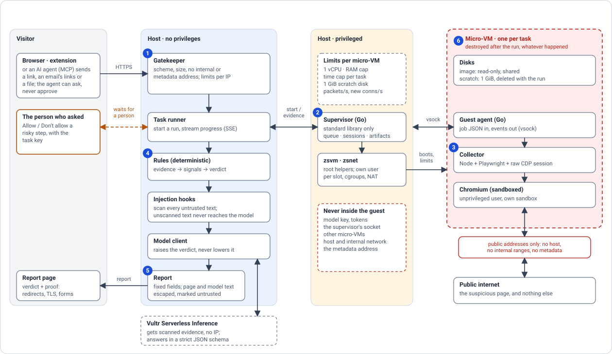

# Architecture

How a check runs, how the containment is met and verified, what it is built from, and where each piece lives. The visitor's view is in [features.md](features.md); the nine containment rules are in [containment.md](containment.md).

*The path of one check. Red marks where hostile content lives: nothing but evidence leaves it, and the micro-VM is destroyed afterwards. The numbers are the steps below.*

## How it works

1. A gatekeeper checks the submitted address (scheme, size, no internal or cloud-metadata addresses) before anything runs.
2. A Go supervisor starts a one-shot Firecracker micro-VM, as a user of its own for that slot. The guest image is attached read-only and shared; everything the guest writes goes to an empty scratch disk of its own (1 GiB), laid over the image at boot and deleted with the run.
3. A collector inside the micro-VM (Node.js, Playwright, driven over the Chrome DevTools Protocol so client-side redirects aren't invisible) opens the target in a sandboxed, unprivileged Chromium and reports every request, redirect, form, download attempt, and dialog as it happens.
4. Deterministic rules turn that evidence into signals; a Vultr Serverless Inference model may add to the plan or raise the verdict, never lower it below what the rules found.
5. The report is built from a fixed list of fields — anything the page, the submitter, or the model wrote is escaped and clearly marked as untrusted text, never trusted as a size, a boolean, or a command.
6. The micro-VM is destroyed, whatever happened.

## Containment in practice

Verified from *inside* a real guest, as the same unprivileged user the browser runs as (`deploy/test/containment-e2e.sh`): no write access outside the task, no secrets on disk or in any readable environment, no shared mounts, only the read-only image and its own scratch disk, no route to the host, the cloud metadata address, or the host's gateway; a guest that fills its disk stops at its scratch disk. And from inside the sandbox Firecracker itself runs in (`deploy/test/zsvm-isolation.sh`): no reach to the supervisor's socket, state or settings, other micro-VMs, the logs or the code, and no other process seen or signalled.

The full set of nine rules every change must keep is in [docs/containment.md](containment.md).

Untrusted input (page text, OCR, file names) is treated as data a model reads, never as instructions it follows; a model can only push a verdict up, never down; deterministic hooks scan every piece of untrusted text before and after a model call, in a worker thread with a deadline, and can fall back to rules-only on their own. A text they could not inspect in time keeps the model away too, but is not counted against the page.

## Stack

| Layer | Choice |
|---|---|
| Host | Rocky Linux 10, Firecracker, KVM, SELinux Enforcing |
| Guest image | Ubuntu 24.04 (packages from a pinned snapshot of the archive), Node.js 24, Playwright 1.65.0, Chrome Headless Shell (pinned checksum); built step by step in namespaces of its own, read-only in every micro-VM |
| Supervisor (privileged) | Go, standard library only — microVM lifecycle, queueing, sessions, artifacts, over a Unix socket |
| Collector (in the guest) | Node.js, Playwright + a raw CDP session |
| Web layer and agent (unprivileged) | Node.js 24, TypeScript (type-stripping, no build step), [Hono](https://hono.dev/) |
| Interface | React 19, React Router 8, TanStack Query, Tailwind CSS 4, built with Vite; strict CSP, no inline scripts or styles |
| Model | Vultr Serverless Inference, OpenAI-compatible, a thin `fetch` client with a strict response schema — no SDK |
| Proxy / TLS | Caddy |

## Where things live

The directory a piece of code sits in tells you its privilege level and where it actually runs — that's the organizing rule, not the language:

| Directory | What's in it | Where it runs |
|---|---|---|
| `supervisor/` | Go, standard library only: microVM lifecycle, the queue, sessions, artifacts | **Host, privileged** — the only thing allowed to touch Firecracker, cgroups and the guest network |
| `web/` | `hooks/` (injection detectors, rules as data), `agent/` (rules, model client, verdict, report), `server/` (the Hono API: tasks, progress stream, report, chat, approvals; serves the built client) | **Host, unprivileged** — no access to Firecracker or the supervisor's socket beyond its own API |
| `web/client/` | The interface: React, React Router, TanStack Query, Tailwind; light and dark themes, or the system's | **In the visitor's browser**; only the build reaches the host |
| `web/shared/` | `api-types.ts`: the shapes of the site's HTTP API, with no imports; the server builds its answers from them and the client reads them, so a field renamed on one side stops the type check on the other | Types only, erased at run time |
| `web/extension/` | The browser extension (Manifest V3): the agent in a side panel, built with the client's tools; reads no page | **In the visitor's browser** |
| `web/tools/` | Dev tooling: mutation testing, the corpus check, model benchmarking, the quality run on live phishing and walled sites, a deep check through the extension, the DB-IP fetch script | Run by hand or in CI, never by the running service |
| `mcp/` | The MCP server for AI agents (Node, no dependencies, over standard input and output): a thin client of the site's HTTP API that returns verdicts without ever returning the key that approves; tests against a fake service and a mutation check | The agent's computer, as a child process of its client |
| `guest/` | `agent/` (the Go job receiver, over vsock), `collector/` (Node.js + Playwright over a raw CDP session), `image/` (builds the guest disk image) | `agent/` and `collector/` run **inside the guest micro-VM** as an unprivileged user; `image/` runs on the host only to build the image |
| `config/` | `web.env` (holds the model key) and `supervisor.env`, git-ignored; their `*.example` templates are in git | Read by systemd for the services |
| `deploy/` | `steps/` (what `./zs install` runs), `versions.env` (every pinned version and checksum), `files/` (the few system files: units, sudoers, sysctl, udev, logrotate), `helpers/` (`zsvm`, `zsnet`), `test/` (tests on real micro-VMs) | **Host**, at install time |
| `docs/` | [Install and operate](install.md), [configuration](configuration.md), [containment rules](containment.md), [privacy policy](privacy.md), [terms of use](terms.md) | Documentation only |
| `build/` | Everything generated (binaries, the built client, check screenshots); git-ignored | — |

On a server the checkout lives at `/zerostress` and everything else lives next to it, git-ignored: `bin/` (Firecracker, the root helpers, Caddy, the supervisor), `runtime/` (Node, Go), `images/` (the guest image), `data/`, `logs/`, `run/`. One command, `./zs`, installs, updates, starts, shows logs, edits settings and verifies.
